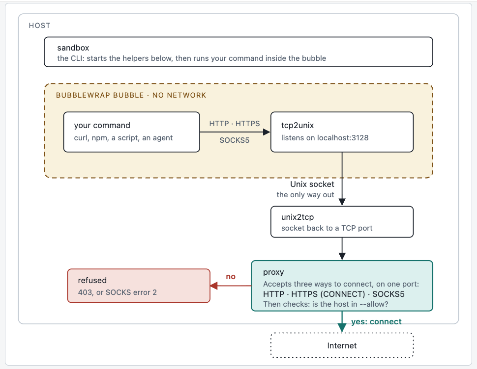

<p align="center">
  
</p>

I find the [Anthropic Sandbox Runtime](https://github.com/anthropics/sandbox-runtime) project pretty interesting, so I decided to implement a simplified version of it based on Linux and [Bubblewrap](https://github.com/containers/bubblewrap).

The purpose of this project is to learn how to work with OS primitives and networking, and to dust off my knowledge of coroutines and channels in Go.

## Install

Linux only. `install.sh` installs Go and Bubblewrap if they are missing, then builds `sandbox`. Only the installs need `sudo` (it may ask for your password); the build runs as your user and writes to `~/.local/bin`:

```sh
# Downloads install.sh and runs it in one go
curl -fsSL https://raw.githubusercontent.com/gppmad/sandboxing-prototype/main/install.sh | sh
```

## Usage

```sh
# Only the hosts given with --allow can be reached
sandbox --allow example.com -- curl https://example.com     # works
sandbox --allow example.com -- curl http://example.com      # works
sandbox --allow example.com -- curl https://wikipedia.org   # refused

# SOCKS5: curl needs to be told, and must use socks5h (not socks5)
sandbox --allow example.com -- curl --proxy socks5h://localhost:3128 https://example.com

# --allow takes several hosts, up to the "--"; with none, all network access is refused
sandbox --allow example.com github.com -- npm install
```

## How it works

<p align="center">
  
</p>

The command runs in a Bubblewrap bubble with no network, so the only way out is a Unix socket that leads to the proxy on the host. The proxy accepts HTTP, HTTPS (`CONNECT`) and SOCKS5 on one port, and connects only to hosts given with `--allow`.
